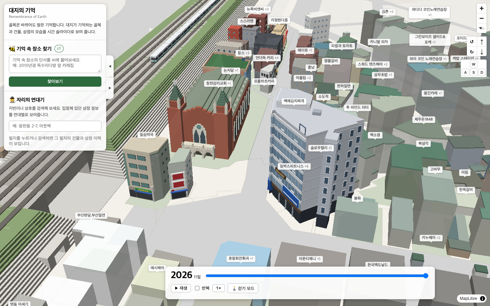
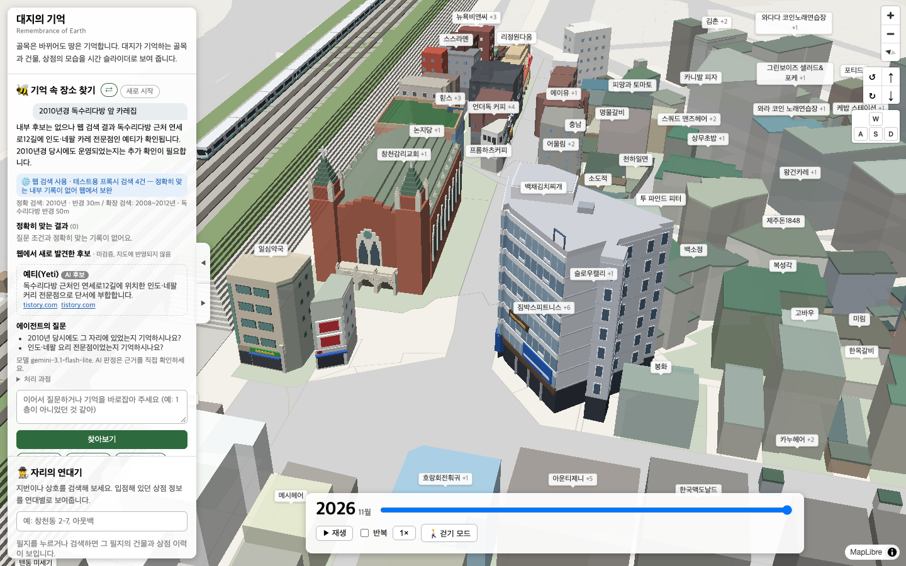
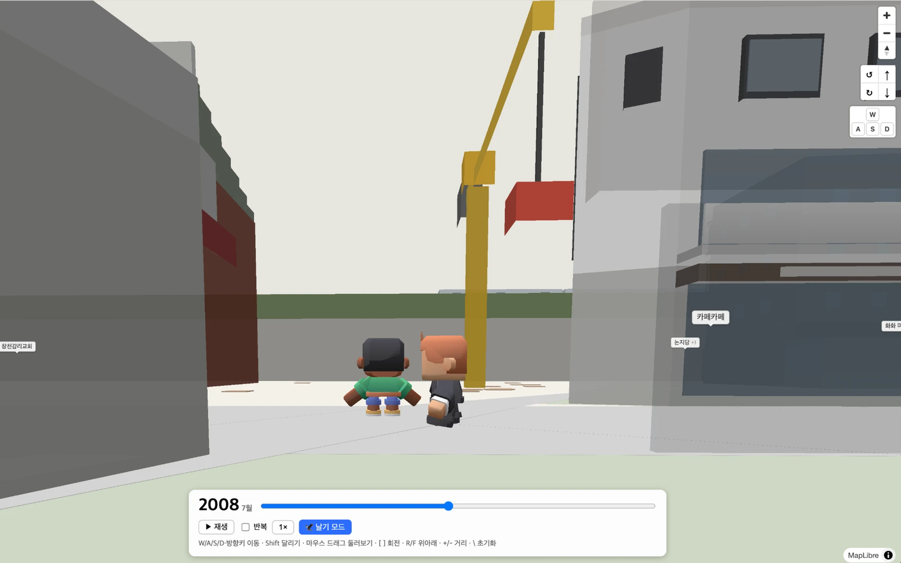
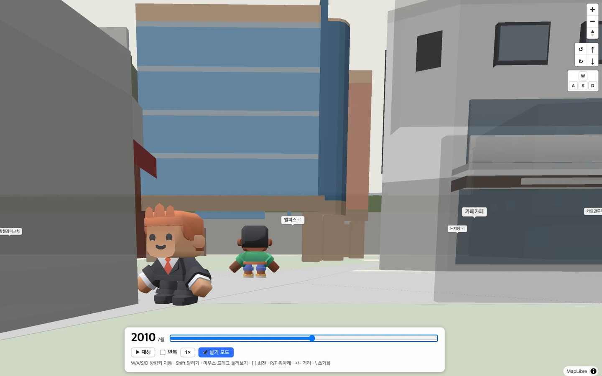
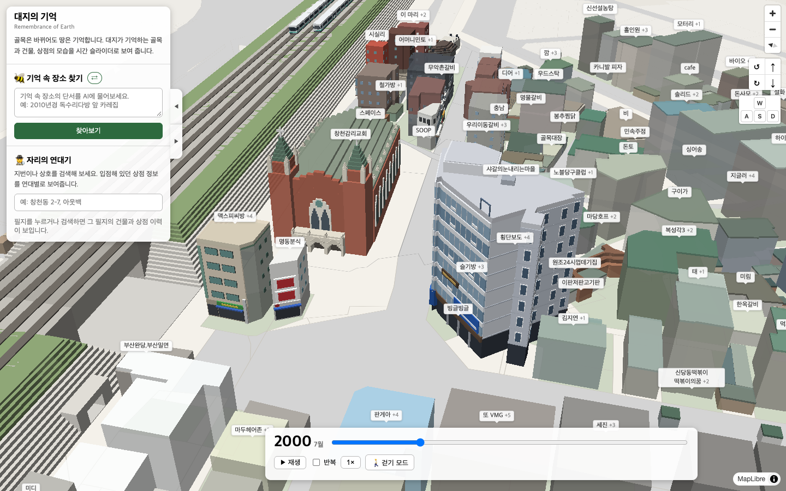
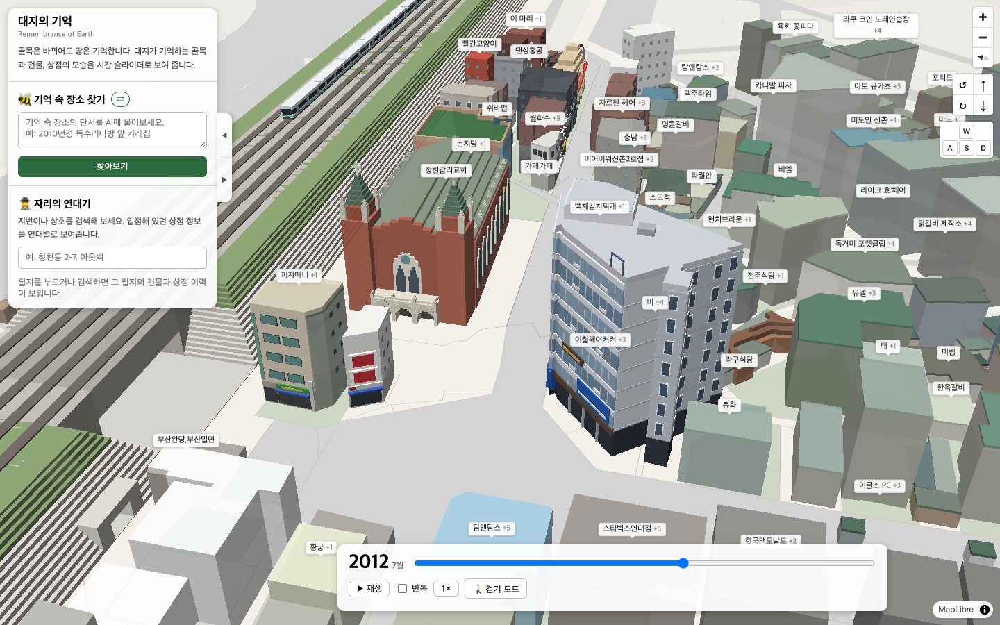
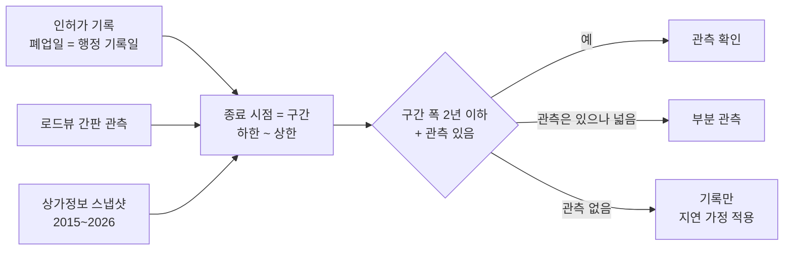

# 대지의 기억 (Remembrance of Earth)

> 한 골목의 건물과 가게가 시간에 따라 어떻게 바뀌었는지, 지도 위에서 되감아 보는 2.5D 타임머신.
> 대상지: 서울 서대문구 창천동 · 연세로12길(신촌)



라이너 .EXE-THON 출품작입니다. **기억 속 장소 찾기**(AI 에이전트)와 **골목의 연대기**(영역 분석 리포트) 두 기능을 Liner Model·Liner Search로 구현했습니다.

<!-- TODO(제출 전): 데모 영상 링크, 기획서 PDF 링크 -->

## 해결하려는 문제

가게는 빠르게 바뀌지만, 지난 가게의 이력은 어디에도 한곳에 모여 있지 않습니다. 인허가 기록에는 날짜만 있고 위치는 지번뿐이며, 폐업일은 행정 기록일이라 실제 폐업과 어긋납니다. 사람의 기억은 "신촌 어디쯤 있던 카페" 정도로 흐릿합니다.

| 사용자 | 하고 싶은 일 | 이 프로젝트의 답 |
|---|---|---|
| 그 골목을 기억하는 사람 | 이름이 안 떠오르는 가게를 찾는다 | 흐릿한 단서(시기·업종·상호 조각·층·위치)를 AI가 해석하고 후보와 근거를 보여 줍니다 |
| 상권을 보는 사람 | 한 영역의 업종 구성과 영업 기간이 어떻게 변했는지 안다 | 영역을 그리면 AI 없이 고정 형식 리포트가 즉시 나오고, 질문하면 AI가 리포트를 읽고 답합니다 |
| 그 골목이 궁금한 누구나 | 연도별로 건물과 가게를 본다 | 시간 슬라이더로 건물이 올라가고 사라지며, 가게 라벨이 바뀝니다 |

## 기능

### 1. 기억 속 장소 찾기 (AI 에이전트)
"2010년쯤 1층에 있던 카페, 이름에 '달'이 들어갔던 것 같아"처럼 말하면 다음을 거칩니다.
1. **단서 해석** (Liner Model): 시기·업종·상호 조각·층·위치를 구조화합니다. 말하지 않은 값은 추측하지 않습니다.
2. **정확 검색 + 확장 검색** (코드): 조건 그대로 찾고, 기억이 틀렸을 수 있어 시기 ±2년·반경 50m씩 넓힌 결과를 따로 보여 줍니다.
3. **웹 검색** (Liner Search): 내부 기록이 약하거나 사용자가 원할 때만 씁니다. 썼는지 항상 표시합니다.
4. **판정** (Liner Model): 확인 / 추정 / 미확인으로 구분하고, 근거 없는 내용은 만들지 않습니다.

<!-- TODO(제출 전): 04_agent.png, 06_question.png 는 테스트용 프록시로 찍어 화면에 '테스트용 프록시' 표시가 보인다. Liner로 최종 평가할 때 scripts/capture_readme_1.mjs, _2.mjs 로 다시 찍는다. -->



### 2. 골목의 연대기 (영역 분석)
- 사각형·원·다각형으로 영역을 고르면 필지가 자동 선택되고, **AI 없이** 5개 섹션 리포트(개요, 업종 구성, 영업 기간, 자리 이력, 한계)가 바로 나옵니다.
- 질문을 덧붙이면 그때만 AI가 리포트의 사실 목록을 읽고 답합니다. 답 속 숫자는 코드가 사실 목록과 대조해, 어긋난 문장은 버립니다. 원인을 묻는 질문에만 웹 검색을 쓰고, 계산 수치와 웹 근거를 섞지 않습니다.
- 폐업 시점은 점이 아니라 **범위**로 다룹니다(아래 '데이터와 한계').


질문을 덧붙이면 그때만 AI가 리포트를 읽고 답합니다.


### 3. 시간 지도
MapLibre 2.5D 지도와 three.js 걷기 모드, 시간 슬라이더. 건물은 건축물대장과 인허가로 착공·준공·철거를 그리고, 가게는 인허가와 로드뷰 간판 판독으로 시기별 라벨을 단 것입니다.

건물도 시간에 따라 올라갑니다. 건축물대장·인허가의 착공일과 사용승인일에 맞춰, 공사 중인 건물은 크레인과 함께 높이가 올라가고 완공되면 완성된 모습이 됩니다. 아래는 걷기 모드에서 같은 자리를 지켜본 창천동 47-39(백주년기념관)로, 신축 착공(2008-07-04)부터 사용승인(2010-03-30)까지입니다.

| 2008년 7월(착공 무렵) | 2009년 5월(공사 중) | 2010년 7월(완공) |
|---|---|---|
|  |  |  |

같은 자리를 연도만 바꿔 보면 가게 라벨이 달라집니다.

| 2000년 7월 | 2012년 7월 | 2026년 11월 |
|---|---|---|
|  |  |  |

걷기 모드에서는 골목 안으로 내려가 걸으며 그 시기의 간판을 볼 수 있습니다. 걷기·달리기 동작이 있고, 뒤로 가면 캐릭터가 돌아서 앞모습으로 걸어옵니다. 행인과 동물은 골목을 돌아다니는 장식용 NPC입니다.


| 2008년 7월(그때의 가게 라벨) | 뒤로 걸을 때(앞모습) | 위로 올려다보기(창천교회) |
|---|---|---|
|  |  |  |


## Liner API 활용

| 위치 | 호출 | 용도 |
|---|---|---|
| `server/agent.py` | Model (chat/completions, JSON 스키마) | 단서 해석, 후보 판정 |
| `server/agent.py` | Search (`/tools/search/web`) | 웹 근거 수집 |
| `server/area_agent.py` | Model | 리포트에 대한 후속 질문 답변(관점 선택·답·근거 표시를 한 번에) |
| `server/area_agent.py` | Search | 원인을 묻는 질문에서만 외부 맥락 수집 |
| `scripts/estimate_category.py` | Model + Search | 업종 불명 상호의 업종 추정(빌드 단계) |

클라이언트는 `server/liner.py`(표준 라이브러리만 사용)입니다. 기본 모델은 `anthropic/claude-haiku-5.5`이고 `LINER_MODEL`로 바꿉니다. 키 오류(401/402/403)가 나면 `LINER_API_KEY_fallback`으로 넘어갑니다.

개발 중에는 `.env`의 `LLM_PROVIDER=cliproxyapi`로 모델 호출을 프록시에 돌려 비용을 아꼈습니다. **제출·심사 환경에서는 이 줄을 켜지 않으며, 기본값이 Liner입니다.**

## 실행

요구: Python 3.10+ (서버는 표준 라이브러리만 사용), 최신 브라우저.

```bash
cp .env.example .env        # LINER_API_KEY 값을 채운다
python3 server/app.py 8765  # http://localhost:8765
```

- 서버가 `web/` 정적 파일과 `/api/find`(기억 찾기), `/api/area`(영역 분석)를 함께 제공합니다. `python -m http.server`만으로는 AI 기능이 동작하지 않습니다.
- `LINER_API_KEY` 없이도 지도, 시간 슬라이더, 자리의 연대기 검색, 영역 리포트(AI 없는 부분)는 동작합니다.
- 서버 코드를 고치면 서버를 다시 시작해야 합니다.

### 데이터를 다시 만들려면 (선택)
저장소에 가공된 데이터(`data/`, `web/scene.json`)가 들어 있어 실행에는 필요 없습니다. 원본(`data/raw/`)은 용량이 커서 올리지 않았습니다.
- 수집·가공 스크립트: `scripts/`
- 소상공인시장진흥공단 상가(상권)정보 스냅샷: 원본 CSV를 `data/raw/`에 두고 `python3 scripts/extract_semas.py`, `python3 scripts/match_semas.py`
- 필요한 공공데이터 키: `.env.example` 참고(V-World, 건축HUB, 서울 열린데이터광장 등)

### 평가 스크립트
```bash
python3 -I scripts/eval_search.py      # 기억 찾기: 정답 가게가 후보 상위에 오르는가(AI 호출 없음)
python3 -I scripts/eval_area.py        # 영역 리포트 불변식·결정성·구간 보정 효과(AI 호출 없음)
python3 -I scripts/eval_area.py --ai   # AI 해설 평가(호출이 발생. --liner 는 --max-cost 필수)
```

## 데이터와 한계

| 자료 | 쓰임 |
|---|---|
| 건축물대장·폐쇄말소대장·건축인허가(건축HUB) | 건물 이력 |
| 서울시 인허가(일반음식점 등 4종) | 가게의 개업·폐업 기록 |
| 로드뷰 간판 판독(2008~2026, 연세로12길 구간) | 영업 중이던 시점의 관측 |
| 소상공인시장진흥공단 상가(상권)정보(2015~2025 연말, 2026-09 스냅샷 12개) | 영업 중 관측, 폐업 시점 하한 |

핵심 원칙: **인허가의 폐업일은 행정 기록일이라 실제보다 늦을 수 있다**(식품위생법 제37조에는 폐업신고 기한이 없습니다). 그래서 종료 시점을 [하한, 상한] 구간으로 두고 근거 등급(관측 확인 / 부분 관측 / 기록만)을 붙입니다. 관측이 없는 업소는 관측이 있는 업소에서 잰 지연의 75백분위(현재 1.0년, 131건)를 가정하며, 가정을 바꿨을 때의 민감도도 리포트에 표시합니다. 표본이 10곳 미만이면 수치 대신 "표본 부족"으로 표시합니다.



현재 한계(숨기지 않습니다):
- 폐업 업소의 약 76%는 기록상 날짜만 있습니다. 폐업의 약 70%가 2016년 이전이라 상가정보 스냅샷이 닿지 않습니다.
- 로드뷰 조사는 연세로12길 구간에만 있고, 반경 150m 확장 구간은 인허가 기록만입니다.
- 인허가 대상이 아닌 업종(옷가게, 사무실 등)은 기록에 없습니다.
- 예측·창업 추천·매출·임대료·유동인구는 다루지 않습니다.

## 다른 동네에 적용하기

동네 설정은 `config/region.json` 한 파일에 모았습니다(동·구 이름, 검색어, 지역 판별 단어, 지도 중심과 시작 시점). 분석·검색 엔진, 데이터 추출 스크립트, 웹 화면이 이 파일을 읽습니다.
이 저장소의 3D 건물 정밀 매싱(`scripts/landmark_*.py`)과 철도 둑은 창천동을 손으로 만든 선택 층이라 다른 동네에는 없어도 동작하도록 분리하는 것이 다음 과제입니다.

## 신청 때 계획과 구현 범위

참가 신청 때는 AI 에이전트가 공공데이터를 직접 조사해 건물·상호 이력을 복원하고, 창천교회 일대에서 시작해 바깥으로, 또 다른 지역으로 조사 범위를 넓혀 가는 것을 목표로 했습니다. 방향을 바꾼 것이 아니라 **주어진 크레딧 안에서 구현하다 보니 거기까지 가지 못한 것**입니다.

- 지급된 Liner 크레딧 $200은 개발 사흘(11/12~11/14) 만에 거의 다 쓰였습니다(Liner 대시보드 기준 사용 $199.82).
- 가장 큰 원인은 게이트웨이 응답 문제였습니다. 개발 중 "서비스가 혼잡합니다" 오류(게이트웨이 524 타임아웃 포함)가 반복됐고, 재시도와 모델 변경 때마다 긴 대화 맥락이 처음부터 다시 입력됐습니다. 맥락이 한도를 넘은 뒤에는 화면에는 보이지 않은 채 내부에서 재시도·폴백이 이어졌고, 구현 결과 없이 크레딧이 소모됐습니다. 꼬인 것은 걷기 모드 개선 세션이었습니다(캐릭터가 걷지 않고 떠다니고 앞뒤 구분이 없던 것을, 걷기·달리기 동작과 이동 방향으로 돌아서는 동작, 골목을 돌아다니며 어울리는 행인(NPC)으로 바꾸려던 작업). 이 세션에서 구현 없이 $100 이상이 소모된 것으로 기억합니다(작업자 기억이며 세션별 비용으로 확인하지 못한 값). 하루 최대 사용액($135.02, 11/13)이 전부 오류 때문은 아니지만, 이 세션을 중단하고 새 세션에서 같은 기능을 다시 만들었을 때는 약 $10~15(같은 기억)로 완성됐습니다. 오류에 낭비된 몫이 크다고 보는 근거입니다.
- 남은 크레딧으로는 앱이 런타임에 AI로 조사를 돌리는 구조를 둘 여유가 없어, 조사(수집·매칭·판독)는 스크립트로 미리 수행해 데이터로 굳혔습니다.
- 그 위에서 AI는 기억 단서를 해석하고, 후보를 근거와 대조해 판정하고, 영역 리포트에 대한 질문에 답하는 일을 맡습니다. 이 부분을 유지하는 것도 빠듯해서, 개발·평가 중에는 모델 호출을 프록시로 돌리고 제출 직전에만 Liner로 확인합니다.
- 그 결과 지금 조사된 범위는 연세로12길 구간(로드뷰 포함)과 반경 150m(인허가·상가정보)입니다. 범위를 더 넓히거나 다른 지역을 조사하는 에이전트는 구현하지 못했습니다.
- 대신 그 확장을 위한 바탕은 마련했습니다. 동네 설정을 `config/region.json` 한 파일로 모았고, 분석·검색 엔진과 데이터 추출 스크립트가 이 파일을 읽습니다.

## 이미 있던 것과 새로 만든 것

참가 신청(11/2~11/11) 때 쓴 기획서와 준비 자료를 빼면, 코드와 지도는 개발 시작일(11/12) 이후에 새로 만들었습니다. 신청 전에 만든 소프트웨어는 없고, 저장소의 첫 커밋도 11/13입니다.

| 구분 | 내용 |
|---|---|
| 11/12 이전에 있던 것 | 참가 신청 기획서(아이디어 수준)와 개발 설계서 v0.1, 신촌 한 골목의 로드뷰 간판 판독 자료 |
| 개발 기간(11/12~)에 새로 만든 것 | 데이터 수집·가공 파이프라인, 2.5D 지도와 걷기 모드, 기억 속 장소 찾기 에이전트, 골목의 연대기 분석, 평가 스크립트, 동네 설정 분리 |

개발에는 Claude Code를 Liner 게이트웨이로 구동했습니다. 걷기 모드의 캐릭터·동물 3D 모델은 Kenney의 CC0 에셋입니다(`web/assets/` 라이선스 파일 참고).
