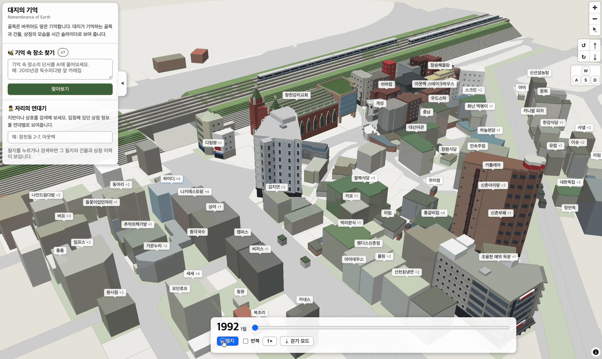
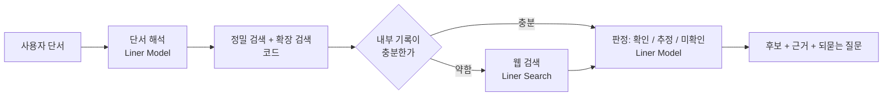
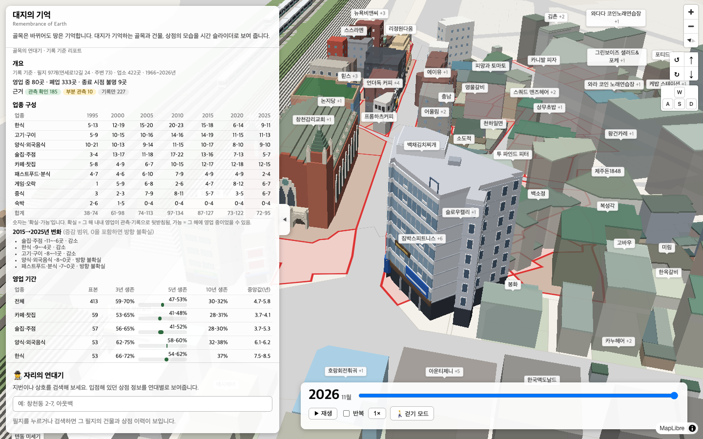
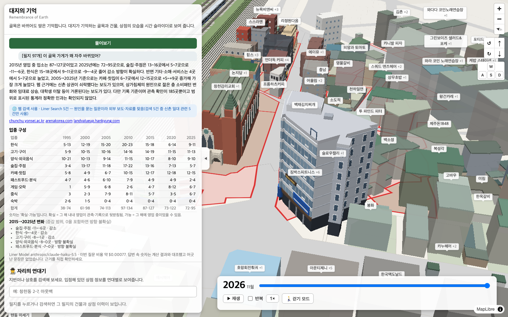
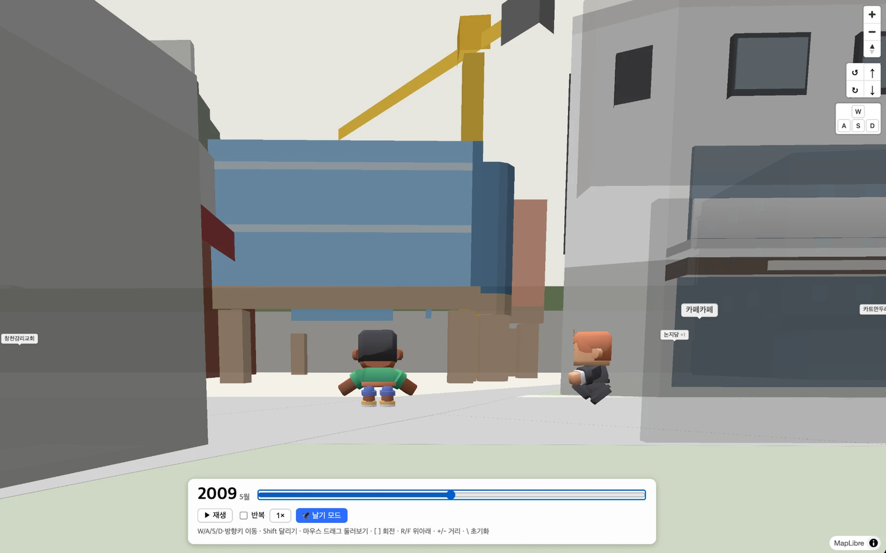
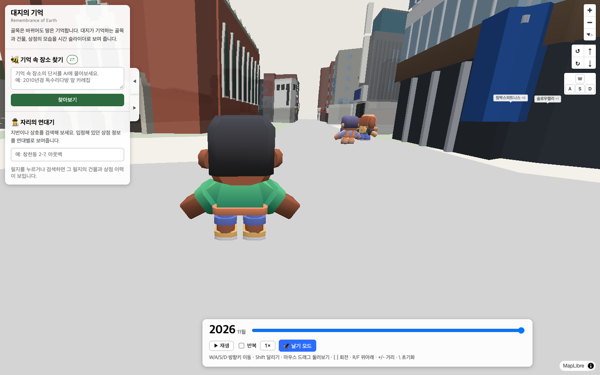
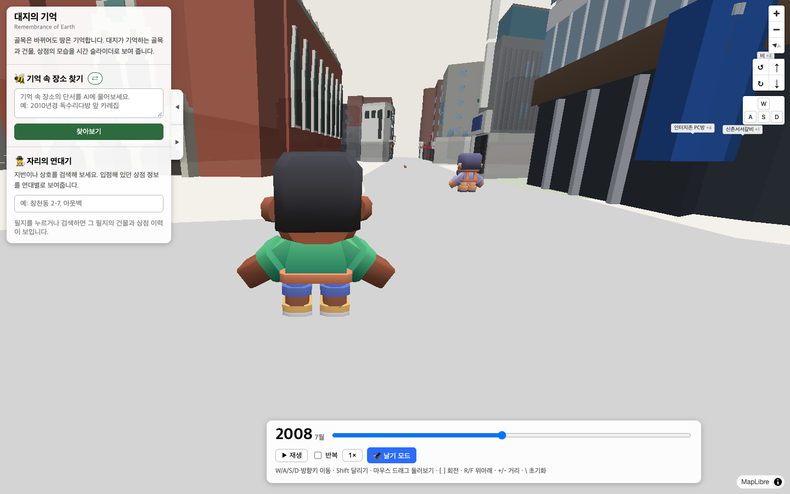
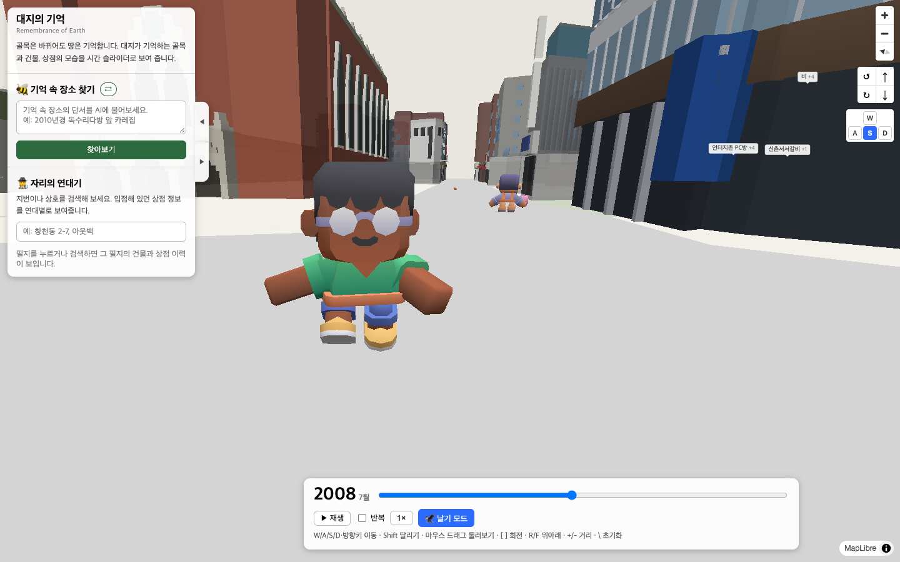
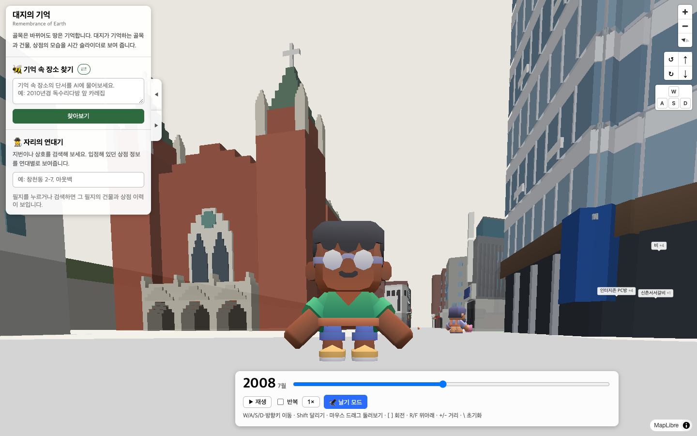
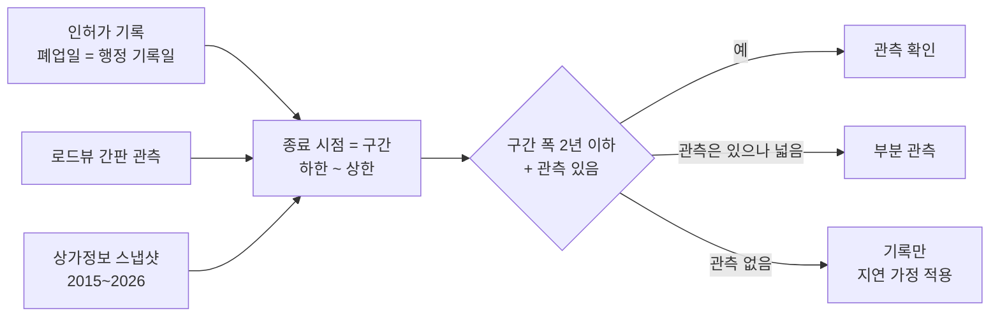

# 대지의 기억 (Remembrance of Earth)

> 한 골목의 건물과 가게가 시간에 따라 어떻게 바뀌었는지, 지도 위에서 되감아 보는 2.5D 타임머신.  
> 대상지(MVP): 서울 서대문구 창천동 일대(신촌)



라이너 .EXE-THON 출품작입니다. **기억 속 장소 찾기**(AI 에이전트)와 **골목의 연대기**(영역 분석 리포트) 두 기능에 Liner Model과 Liner Search를 사용했습니다. 지금은 MVP라서 연세로12길 구간과 그 주변 반경 150m만 구현했습니다.

**제출 자료:** [기획서(PDF)](%EB%8C%80%EC%A7%80%EC%9D%98%20%EA%B8%B0%EC%96%B5%28Remembrance%20of%20Earth%29%20%EA%B8%B0%ED%9A%8D%EC%84%9C.pdf) · [데모 영상](https://youtu.be/tsZ58sQ1QgE)

## 왜 '대지의 기억'인가

시작은 개인적인 경험이었습니다. 오래전 4개월 동안 아르바이트했던 학원의 이름이 떠오르지 않았습니다. 지도에서 찾아봐도 정확한 위치가 기억나지 않았고, 구글 검색에는 폐업한 지 오래돼서인지 관련 정보가 없었습니다. 기억나는 단서 조각을 AI에 물어보고 과거 로드뷰 이미지까지 총동원해서야 학원의 위치와 이름을 겨우 찾을 수 있었습니다. 그 건물은 이미 오래전에 재건축됐고 주변도 재개발로 아파트 단지가 들어서서, 현재 로드뷰로는 동네를 알아보기조차 어려웠습니다.

건물과 가게는 바뀌고 사라지지만 땅은 그 자리에 남습니다. 건축법에서 '대지'는 필지로 나눈 땅을 뜻합니다. 건축물대장과 인허가 기록은 이 필지(지번)를 기준으로 쌓이고, 간판 관측도 지번에 붙일 수 있습니다. 그래서 흩어진 기록을 필지 위에 시간순으로 쌓으면 사라진 건물과 가게도 그 자리의 이력으로 되살릴 수 있다고 보았습니다. 시간 슬라이더를 과거로 돌리는 것이 곧 그 자리의 기억으로 떠나는 시간여행입니다. 지도 화면 머리말도 "골목은 바뀌어도 땅은 기억합니다"입니다. 영문 이름 Remembrance of Earth는 판타지 소설 <묵향>에서 대지에 남은 과거의 흔적을 읽어 그곳의 모습을 되살리는 마법 'Remembrance of the Earth'에서 따왔습니다.

처음에는 추억의 장소를 찾으려는 도구였지만, 점포가 입점해 있던 기간을 시간 슬라이더로 보이고 필지 위에 정보를 쌓다 보니 골목 상권의 변화와 유행의 흐름도 읽을 수 있었습니다. 가게가 한 번지에서 더 외곽의 다른 번지로 옮겨 가는 모습을 보면 젠트리피케이션이 일어났는지도 살펴볼 수 있습니다. 기억 속 장소 찾기와 골목의 연대기, 두 기능은 이렇게 한 경험에서 나왔습니다.


## 해결하려는 문제

가게는 빠르게 바뀌지만 지난 가게의 이력은 한곳에 모여 있지 않습니다. 인허가 기록에는 날짜와 지번만 있고 폐업일은 행정 기록일이라 실제 폐업과 어긋납니다. 사람의 기억은 "신촌 어디쯤 있던 카페" 정도로 흐릿합니다. 이 프로젝트는 흩어진 기록을 지도 위에 쌓아 흐릿한 기억에서 가게를 찾고 한 골목의 변화를 읽게 합니다.

## 기능

### 1. 기억 속 장소 찾기 (AI 에이전트)

"2010년쯤 1층에 있던 카페, 이름에 '달'이 들어갔던 것 같아"처럼 말하면 다음 순서로 찾습니다.

1. **단서 해석** (Liner Model): 시기·업종·상호 조각·층·위치를 구조화합니다. 말하지 않은 값은 추측하지 않습니다.
2. **정밀 검색 + 확장 검색** (코드): 조건 그대로(위치는 반경 50m) 찾고, 기억이 틀렸을 수 있으니 시기 ±2년·반경 100m로 넓힌 결과를 따로 보여 줍니다. 범위를 넓힐 때마다 ±2년·100m씩 늘어납니다.
3. **웹 검색** (Liner Search): 내부 기록이 약하거나 사용자가 원할 때만 씁니다. 썼는지 항상 표시합니다.
4. **판정** (Liner Model): 확인·추정·미확인으로 구분하고 근거 없는 내용은 만들지 않습니다.




### 2. 골목의 연대기 (영역 분석)

- 사각형·원·다각형으로 영역을 고르면 필지가 자동으로 선택되고 **AI 없이** 5개 섹션 리포트(개요, 업종 구성, 영업 기간, 자리 이력, 한계)가 바로 나옵니다.
- 질문을 덧붙이면 그때만 AI가 리포트의 사실 목록을 읽고 답합니다. 답 속 숫자는 코드가 사실 목록과 대조해 어긋난 문장을 버립니다. 웹 검색은 원인을 묻는 질문에만 쓰고 계산 수치와 웹 근거는 섞지 않습니다.
- 폐업 시점은 한 점이 아니라 **범위**로 다룹니다(아래 '데이터와 한계').





### 3. 시간 지도

MapLibre 2.5D 지도에 시간 슬라이더와 three.js 걷기 모드를 얹었습니다. 건물은 건축물대장과 인허가의 착공·준공·철거 기록으로, 가게는 인허가와 로드뷰 간판 판독으로 시기별 라벨을 붙입니다.

공사 중인 건물은 착공일과 사용승인일에 맞춰 크레인과 함께 올라가고 완공되면 완성된 모습이 됩니다. 아래는 걷기 모드에서 같은 자리를 지켜본 창천동 47-39(백주년기념관)로, 신축 착공(2008-07-04)부터 사용승인(2010-03-30)까지입니다.

| 2008년 7월(착공 무렵) | 2009년 5월(공사 중) | 2010년 7월(완공) |
|---|---|---|
|  |  |  |

연도만 바꿔도 같은 자리의 가게 라벨이 달라집니다.

| 2000년 7월 | 2012년 7월 | 2026년 11월 |
|---|---|---|
|  |  |  |

걷기 모드에서는 골목 안을 걸으며 그 시기의 간판을 볼 수 있습니다. 캐릭터는 걷고 달리며 뒤로 가면 돌아서 앞모습으로 걸어옵니다. 골목을 돌아다니는 행인과 동물은 장식용 NPC입니다.



| 2008년 7월(그때의 가게 라벨) | 뒤로 걸을 때(앞모습) | 위로 올려다보기(창천교회) |
|---|---|---|
|  |  |  |

## Liner API 활용

| 위치 | 호출 | 용도 |
|---|---|---|
| `server/agent.py` | Model (chat/completions, JSON 스키마) | 단서 해석, 후보 판정 |
| `server/agent.py` | Search (`/tools/search/web`) | 웹 근거 수집 |
| `server/area_agent.py` | Model | 리포트에 대한 후속 질문 답변(관점 선택·답·근거 표시를 한 번에) |
| `server/area_agent.py` | Search | 원인을 묻는 질문에서만 외부 맥락 수집 |
| `scripts/estimate_category.py` | Model + Search | 업종 불명 상호의 업종 추정(빌드 단계) |

클라이언트는 `server/liner.py`(표준 라이브러리만 사용)입니다. 기본 모델은 `anthropic/claude-haiku-5.5`이고 `LINER_MODEL`로 바꿉니다. 키 오류(401/402/403)가 나면 `LINER_API_KEY_fallback`으로 넘어갑니다.

## 실행

요구 사항: Python 3.10 이상(서버는 표준 라이브러리만 사용), 최신 브라우저.

```bash
cp .env.example .env        # LINER_API_KEY 값을 채운다
python3 server/app.py 8765  # http://localhost:8765
```

- 서버가 `web/` 정적 파일과 `/api/find`(기억 찾기), `/api/area`(영역 분석)를 함께 제공하므로 `python -m http.server`만으로는 AI 기능이 동작하지 않습니다.
- `LINER_API_KEY` 없이도 지도, 시간 슬라이더, 자리의 연대기 검색, 영역 리포트(AI 없는 부분)는 동작합니다.

### 평가 스크립트

```bash
python3 -I scripts/eval_search.py      # 기억 찾기: 정답 가게가 후보 상위에 오르는가(AI 호출 없음)
python3 -I scripts/eval_area.py        # 영역 리포트 불변식·결정성·구간 보정 효과(AI 호출 없음)
python3 -I scripts/eval_area.py --ai --liner --max-cost 0.1   # AI 해설 평가(Liner 호출 발생, 비용 상한 필수)
```

## 데이터와 한계

| 자료 | 쓰임 |
|---|---|
| 건축물대장·폐쇄말소대장·건축인허가(건축HUB) | 건물 이력 |
| 서울시 인허가(일반음식점 등 4종) | 가게의 개업·폐업 기록 |
| 로드뷰 간판 판독(2008~2026, 연세로12길 구간) | 영업 중이던 시점의 관측 |
| 소상공인시장진흥공단 상가(상권)정보(2015~2025 연말, 2026-09 스냅샷 12개) | 영업 중 관측, 폐업 시점 하한 |

인허가의 폐업일은 행정 기록일이라 실제 폐업보다 늦을 수 있습니다(식품위생법 제37조에 폐업신고 기한이 없습니다). 그래서 종료 시점을 [하한, 상한] 구간으로 두고 근거 등급(관측 확인·부분 관측·기록만)을 붙입니다. 표본이 10곳 미만이면 수치 대신 "표본 부족"으로 표시합니다.



한계는 다음과 같습니다.
- 폐업 업소의 약 76%는 기록상 날짜만 있습니다. 폐업의 약 70%가 2016년 이전이라 상가정보 스냅샷이 닿지 않습니다.
- 로드뷰 조사는 연세로12길 구간에만 있고 반경 150m 확장 구간은 인허가 기록만 있습니다.
- 인허가 대상이 아닌 업종(옷가게, 사무실 등)은 기록에 없습니다.
- 예측, 창업 추천, 매출, 임대료, 유동인구는 다루지 않습니다.

## 다른 동네에 적용하기

동네 설정은 `config/region.json` 한 파일에 모았습니다(동·구 이름, 검색어, 지역 판별 단어, 지도 중심과 시작 시점). 분석·검색 엔진, 데이터 추출 스크립트, 웹 화면이 이 파일을 읽습니다. 다만 3D 건물 정밀 매싱(`scripts/landmark_*.py`)과 철도 둑은 창천동에 맞춰 손으로 만든 층이라 아직 다른 동네에 쓸 수 없습니다.

## 에셋 출처

걷기 모드의 캐릭터·동물 3D 모델은 Kenney의 CC0 에셋입니다(`web/assets/` 라이선스 파일 참고).
